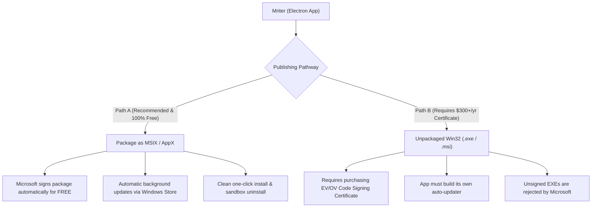
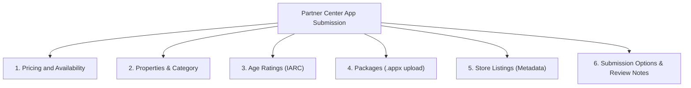

# Complete Guide to Publishing Mriter on the Microsoft Store

> **Status:** 100% Free to publish & distribute  
> **Target Framework:** Electron + React (Packaged as MSIX / AppX)  
> **Repository:** [github.com/Mrinaldo/mriter](https://github.com/Mrinaldo/mriter)  
> **Last Updated:** November 2026

---

## 1. Executive Summary & Cost Verification

### Is it really free to publish on the Microsoft Store?
**Yes.** Microsoft has completely eliminated developer account registration fees:
- **Individual Developer Accounts:** **$0 (Free)** — Previously cost a one-time fee of \$19, now completely waived.
- **Company Developer Accounts:** **$0 (Free)** — Previously \$99, now completely waived.
- **App Submission & Hosting Fees:** **$0 (Free)** — Unlimited submissions and package updates.
- **Store Revenue Share:** **0% cut** taken by Microsoft for non-gaming apps that do not use Microsoft's in-app billing. Since Mriter is a free, open-source desktop studio, you pay **\$0 at every step**.

Instead of an upfront financial barrier, Microsoft now secures the store via **Identity Verification** (a quick identity check with a government ID and selfie).

---

## 2. The Packaging Strategy: Why MSIX / AppX?

When distributing a desktop Win32 application (like an Electron app) via Microsoft Store, there are two pathways:



> [!IMPORTANT]
> **Why Path A (MSIX / AppX) is strongly recommended:**  
> If you upload a standard raw `.exe` installer (Path B), Microsoft **mandates** that the executable be signed with a commercial code-signing certificate from an approved CA (like DigiCert or Sectigo), which costs **\$200–\$500+ every year**.  
> In contrast, when you submit an **MSIX / AppX package (Path A)**, **Microsoft automatically digitally signs your app on ingestion for FREE**. You do not need to buy any third-party certificate!

---

## 3. Preparation Checklist

Before starting, ensure you have:
1. **A Microsoft Account** (your personal Outlook, Hotmail, or business account).
2. **A Government-issued Photo ID** (Passport, Driver's License, or National ID) and a smartphone for identity verification.
3. **Windows 10 or 11** development environment (already in use).
4. **Visual Assets in `build/`** (already generated for you):
   - `StoreLogo.png` (50×50 px)
   - `Square44x44Logo.png` (44×44 px)
   - `Square150x150Logo.png` (150×150 px)
   - `Square310x310Logo.png` (310×310 px)
   - `Wide310x150Logo.png` (310×150 px)
   - `SplashScreen.png` (620×300 px)
5. **A Privacy Policy URL**: A `PRIVACY.md` file is now provided in your repository root. When pushed to GitHub, its URL will be:  
   `https://github.com/Mrinaldo/mriter/blob/main/PRIVACY.md`

---

## 4. Step-by-Step Implementation

### Step 1: Create Your Free Microsoft Partner Center Account

1. Navigate to the [Microsoft Partner Center Registration Portal](https://partner.microsoft.com/dashboard/registration).
2. Sign in with your Microsoft Account.
3. Select **Windows & Xbox** under developer programs.
4. Select **Individual** account (or **Company** if registered as an LLC/Corp with a D-U-N-S number).
5. Complete the **Identity Verification** process:
   - Provide your legal name, country, and contact details.
   - Follow the prompt to verify identity (typically scanning a QR code with your mobile phone to snap your photo ID and a quick selfie).
   - Approval is usually instant or takes a few hours.

---

### Step 2: Reserve the App Name & Obtain Product Identity

Once inside your Partner Center dashboard:
1. Go to **Apps and games** $\rightarrow$ Click **New product** $\rightarrow$ **MSIX or PWA app**.
2. Enter your desired app name: **`Mriter`** (or `Mriter Studio` / `Mriter - Novel Writing Studio` if `Mriter` is already taken).
3. Click **Reserve product name**.
4. In the left sidebar of your new app, go to **Product management** $\rightarrow$ **Product identity**.
5. Keep this page open. You will need three critical values:
   - **Package/Identity Name** (e.g. `12345YourName.Mriter`)
   - **Publisher ID** (e.g. `CN=01234567-89AB-CDEF-0123-456789ABCDEF`)
   - **Publisher Display Name** (e.g. `Your Name` or `Your Studio Name`)

> [!WARNING]
> These three fields must match your `package.json` **exactly** (case-sensitive). If they do not match, the Microsoft Store ingestion scanner will reject the upload.

---

### Step 3: Update `package.json` in Mriter

Open `package.json` and add the `appx` configuration and a build script:

#### A. Add the Build Script (under `"scripts"`):
```json
"dist:store": "npm run build && electron-builder --win appx"
```

#### B. Add the `appx` Target Configuration (inside `"build"`):
```json
{
  "build": {
    "appId": "com.mriter.studio",
    "productName": "Mriter",
    "win": {
      "icon": "public/icon.ico",
      "target": [
        "nsis",
        "portable"
      ]
    },
    "appx": {
      "identityName": "62897MrinaldoInc.Mriter",
      "publisher": "CN=542E7A83-E5F6-41F7-BFB1-740FAE6388C0",
      "publisherDisplayName": "Mrinaldo Inc.",
      "applicationId": "Mriter",
      "displayName": "Mriter",
      "backgroundColor": "#1E1E1E",
      "languages": ["en-US"],
      "capabilities": [
        "runFullTrust"
      ]
    }
  }
}
```

> [!NOTE]
> Configured with your Partner Center identity (`62897MrinaldoInc.Mriter`). The capability `"runFullTrust"` is standard for Electron desktop applications, allowing Mriter to read and write manuscript files to the local file system with native performance.

---

### Step 4: Build the Store Package Locally

Open your terminal in `c:\Users\mrina\MDCodebase\mriter` and run:

```powershell
npm run dist:store
```

**What happens next:**
1. Vite compiles the React TypeScript frontend (`dist/`).
2. Vite compiles the Electron main process and preload scripts (`dist-electron/`).
3. `electron-builder` packages the Win32 binaries into an `.appx` container and includes your tile logos from `build/`.
4. The output file will appear in the `release/` directory:
   ```
   release/Mriter 1.0.1.appx  (or .msix)
   ```

---

### Step 5: Complete the Partner Center Store Submission

In Partner Center, open your reserved app and click **Start your submission**. Work through each section:



#### 1. Pricing and Availability
- **Base Price:** Free
- **Markets:** All markets (worldwide)
- **Discoverability:** Public (available in the Store search)

#### 2. Properties
- **Category:** `Productivity` $\rightarrow$ Subcategory: `Writing & notes` (or `Books & reference`)
- **Privacy Policy URL:**  
  `https://github.com/Mrinaldo/mriter/blob/main/PRIVACY.md`
- **Support Contact Email:** Your developer contact email
- **Website:** `https://github.com/Mrinaldo/mriter`

#### 3. Age Ratings (IARC Questionnaire)
Microsoft uses the International Age Rating Coalition (IARC). Answer the questions honestly:
- Does the app contain violence? **No**
- Does the app contain sexual content or nudity? **No**
- Does the app contain profanity or crude humor? **No**
- Does the app facilitate gambling? **No**
- Does the app share user location? **No**
- Does the app allow users to exchange content/messages online? **No** (Local-first)
- *Result:* An instant worldwide rating of **PEGI 3 / ESRB Everyone**.

#### 4. Packages
- Drag and drop your compiled file: `release/Mriter 1.0.1.appx`.
- Partner Center will validate package architecture (`x64`), version, and identity credentials.

#### 5. Store Listing (Marketing & Visuals)
Use the optimized copy below:

- **App Title:** `Mriter — The Novelist & Publishing Studio`
- **Short Description (100 characters):**
  > *Distraction-free manuscript writing and digital book publishing studio for novelists and authors.*
- **Full Description:**
  ```markdown
  Mriter is a distraction-free desktop manuscript writing and self-publishing studio designed specifically for authors, novelists, and storytellers. Built with a local-first philosophy, all your stories, outlines, and lore remain strictly on your local computer.

  KEY FEATURES:
  • Zen Writing Environment: Clean, focused editor with typewriter vertical scrolling, word targets, reading pace calculations, and distraction-free fullscreen mode.
  • Rich Paper Themes: Warm Cream, Golden Sepia, Midnight Obsidian, and Minimal White paired with literary typography (EB Garamond, Lora, Merriweather).
  • Novel Binder & Structure: Multi-level hierarchy supporting Volumes, Chapters, and Scenes with status tags (Idea, Draft, Revised, Final).
  • Story Bible & Lore Tracking: Deep profiles for characters (protagonists, antagonists, archetypes, motivations) and a world-building lore database.
  • Visual Outliner Matrix: Corkboard-style scene and chapter overview.
  • Book Publishing Studio:
    - EPUB 3 (.epub): Valid, standards-compliant ebooks formatted for Amazon KDP, Apple Books, Kobo, and Barnes & Noble.
    - William Shunn Standard Manuscript (.docx): Industry standard formatting (1-inch margins, 12pt font, double spaced, running headers) ready for literary agents and editors.
    - Print Mockup Preview: Live preview on Kindle e-reader frames, print paper spreads (5.5"x8.5", 6"x9", A5), or mobile with decorative drop caps.
  • 100% Local-First & Private: No telemetry, no cloud lock-in. Your work is stored in open, human-readable files on your own device.
  ```
- **Keywords / Search Terms:**
  `novel`, `writer`, `manuscript`, `author`, `scrivener alternative`, `epub`, `book formatting`, `william shunn`, `zen editor`, `distraction free`, `story bible`, `outliner`
- **Screenshots:**
  - Take 2 to 5 high-resolution screenshots of Mriter on your screen (1920×1080 recommended):
    1. The Zen Editor with manuscript text.
    2. The Story Bible character profile view.
    3. The Outliner / Corkboard matrix.
    4. The Book Publishing / EPUB & Shunn DOCX export preview.
- **Store Logos:** Upload `build/StoreLogo.png` (50×50 px).

#### 6. Notes for Certification
Add a brief note to assist the Microsoft certification reviewer:
> *"Mriter is an offline, local-first manuscript writing and digital book formatting studio. It requires no login credentials, user registration, external internet accounts, or hardware devices. All documents are created and saved directly to the local file system."*

Click **Submit to the Store**.

---

## 5. Certification & Publishing Timeline

1. **Automated Ingestion (10–30 mins):** Scans the package for security, malicious code, and manifest compliance.
2. **Manual Review (24–72 hours):** Microsoft testers check that the application opens cleanly, matches the description, and has a valid privacy policy.
3. **Publication:** Once certified, your application goes live on the Microsoft Store worldwide. You will receive an official Store link (e.g., `https://apps.microsoft.com/detail/...`).

---

## 6. How to Ship Updates in the Future

When you release a new version (e.g., `1.0.2`):
1. Bump the `"version"` in `package.json` to `"1.0.2"`.
2. Run:
   ```powershell
   npm run dist:store
   ```
3. In Microsoft Partner Center, go to Mriter $\rightarrow$ click **Update**.
4. In the **Packages** section, remove the old package and upload `release/Mriter 1.0.2.appx`.
5. Update your release notes under the Store Listing.
6. Click **Submit to the Store**.
7. Existing users will receive the update automatically in the background via Windows Update / Microsoft Store!

---

## 7. Troubleshooting Common Submission Pitfalls

| Issue | Cause | Solution |
| :--- | :--- | :--- |
| **Package identity error during upload** | `identityName` or `publisher` in `package.json` does not match Partner Center | Ensure the strings in `package.json` match **Product Management $\rightarrow$ Product Identity** character-for-character. |
| **Rejection: Missing Privacy Policy** | The URL field was left blank | Supply the GitHub URL: `https://github.com/Mrinaldo/mriter/blob/main/PRIVACY.md`. |
| **Missing image asset warnings** | Image sizes or filenames differ from Store requirements | All 6 required assets are already placed in `build/` with exact dimensions and case-sensitive names. |
| **WACK test failure** | Sideload test failure on local Windows machine | Ensure `"capabilities": ["runFullTrust"]` is specified in `package.json`. |
